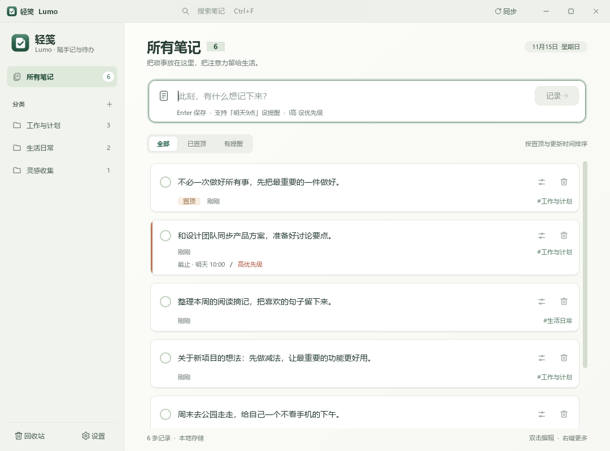
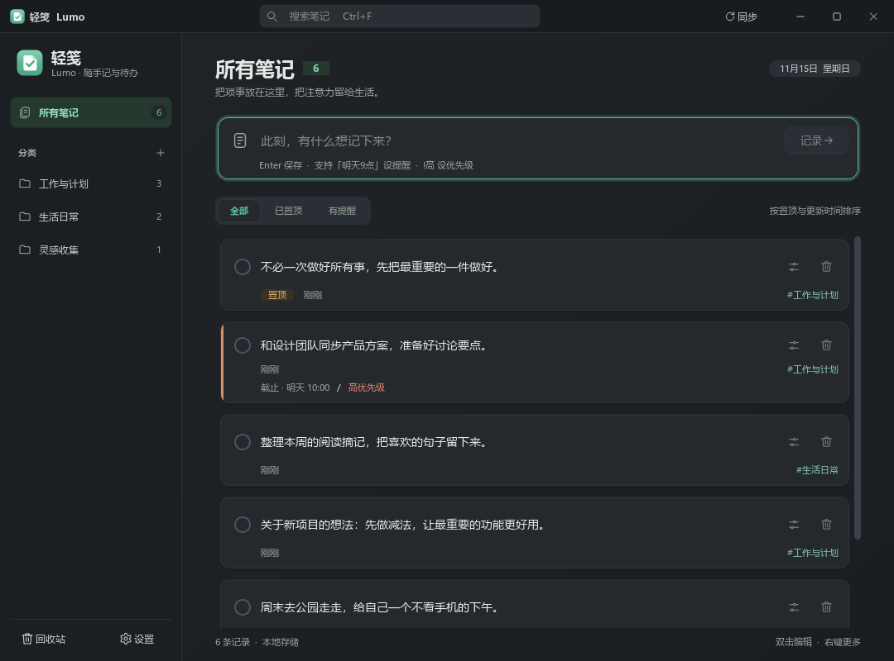
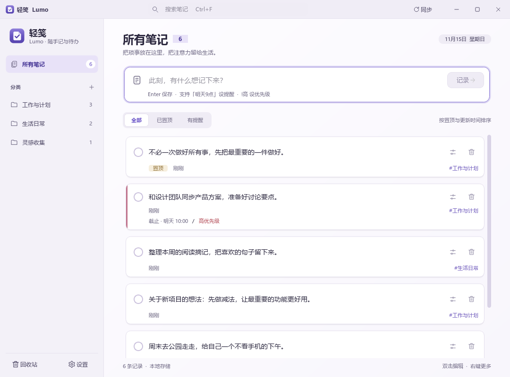
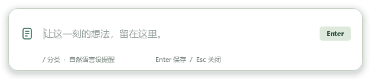
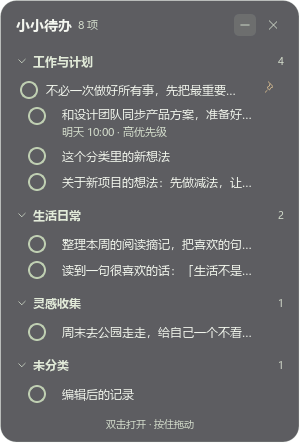
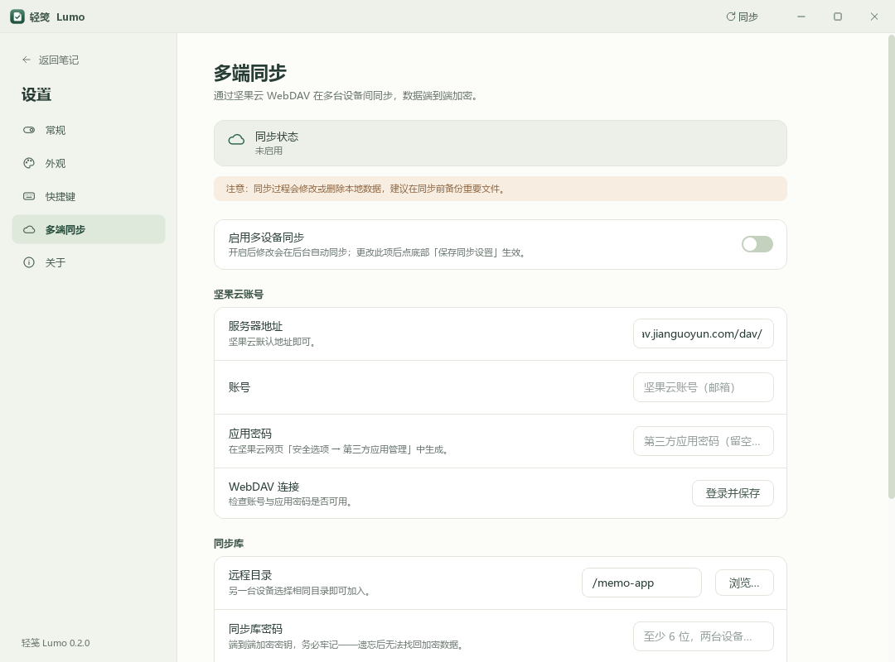

# 轻笺 · Lumo｜Windows 备忘录、桌面便签与待办事项

随手记下灵感，把待办留在桌面。轻笺是一款基于 Python + PySide6 的 Windows 桌面备忘录软件，支持全局快捷记录、分类搜索、截止提醒、桌面待办挂件，以及可选的坚果云 WebDAV 加密同步。

**Lumo is a Windows memo and notes app with desktop sticky notes, to-do lists, reminders, global quick capture, and optional encrypted WebDAV sync.**

[下载 Windows 版](https://github.com/pillowAIQ/lumo-notes/releases/latest) · [同步使用指南](docs/jianguoyun-sync-user-guide.md) · [开发与打包](docs/packaging.md)



## 能做什么

| 场景 | 功能 |
| --- | --- |
| 灵感来了，马上记下 | 默认 **Ctrl+O** 全局呼出快捷输入框，Enter 保存；支持 `/分类名` 和 Tab 补全 |
| 日常笔记与备忘 | 分类、置顶、内容搜索、双击编辑；删除后可从回收站恢复 |
| 管理待办事项 | 优先级、截止时间、重复提醒，支持“明天9点”等自然语言时间输入 |
| 桌面随时查看 | 半透明置顶待办挂件，按分类展开、勾选完成、拖动位置或收起为标题条 |
| 按喜好换皮肤 | 松绿、墨夜、薰衣草三套主题，切换后立即生效 |
| 多台 Windows 电脑接着写 | 可选坚果云 WebDAV 双向同步，AES-256-GCM 加密，支持冲突副本 |
| 本地使用 | SQLite 本地存储，无需配置云端即可记录；关闭主窗口后可驻留托盘 |

## 应用截图

以下均为实际应用界面，使用隔离临时数据库与演示内容生成，不包含个人笔记或账号凭据。

### 三套主题，同一份记录

| 墨夜 · 深色模式 | 薰衣草 · 浅紫主题 |
| --- | --- |
|  |  |

### 快捷记录与桌面待办

在其他应用中呼出输入框，记完继续手头的事；主窗口最小化或隐藏到托盘后，桌面挂件可自动展示未完成事项。





### 在应用内管理同步

设置页集中管理常规、外观、快捷键、多端同步和关于；同步需要自行配置 WebDAV 账号与同步库密码。



## 下载与开始使用

1. 前往 [GitHub Releases](https://github.com/pillowAIQ/lumo-notes/releases/latest)，下载 Windows 分发 ZIP（当前发布文件为 `Lumo-0.2.0-windows-x64.zip`）。
2. **完整解压**压缩包，保留 `Lumo` 文件夹中的全部文件。
3. 运行 `Lumo/Lumo.exe`，输入第一条备忘录，按 Enter 保存。

Windows 分发包自带运行环境，无需另装 Python。不要只复制 `Lumo.exe`，它需要同目录的 `_internal` 依赖。

### 常用操作

| 操作 | 方式 |
| --- | --- |
| 全局快捷记录 | 默认 Ctrl+O，可在「设置 → 快捷键」录制或修改 |
| 搜索笔记 | Ctrl+F；Esc 清空搜索 |
| 保存记录 | Enter |
| 编辑记录 | 双击记录，Enter 保存，Esc 取消 |
| 快捷记录选择分类 | 输入 `/` 后键入分类名，Tab 补全 |
| 打开设置 | 侧栏左下角「设置」，选择分区 |
| 完全退出 | 系统托盘菜单 → 退出 |

默认 Ctrl+O 可能与其他软件的“打开文件”快捷键冲突，建议按自己的习惯修改。系统托盘可用时，关闭主窗口会隐藏到托盘；再次运行应用会唤出已有实例。

## 数据与多设备同步

- 默认数据库：`~/.memo_app/memo.db`；可通过环境变量 `MEMO_APP_DATA_DIR` 指定独立数据目录。
- 备份前先从托盘退出应用，再复制整个数据目录。
- 同步为可选功能，当前主要面向**多台 Windows 电脑**，不提供手机端应用。
- 多台电脑需使用相同远程目录和同步库密码；账号与密码通过 Windows 凭据管理器保存。
- 同步库密码用于解密远端数据，忘记后无法找回。同步会传播编辑和删除，不能代替独立备份。

完整步骤与故障排查见 [坚果云同步用户指南](docs/jianguoyun-sync-user-guide.md)。协议与实现说明见 [同步协议](docs/jianguoyun-sync-protocol.md)。

> 应用曾使用 memo 名称。当前显示名为「轻笺 · Lumo」、可执行文件为 `Lumo.exe`；内部包名 `memo_app`、数据目录、QSettings 与凭据标识沿用原值。

## 从源码运行

使用 Python 3.11 建立虚拟环境。在 Windows PowerShell 中执行：

```powershell
git clone https://github.com/pillowAIQ/lumo-notes.git
cd lumo-notes
py -3.11 -m venv .venv
.venv/Scripts/python.exe -m pip install -e .
.venv/Scripts/python.exe -m memo_app
```

之后可以直接运行 `run.bat`。依赖与包配置见 [pyproject.toml](pyproject.toml)，构建依赖固定版本见 [requirements-build.txt](requirements-build.txt)。

### 验证与打包

```powershell
# 单元测试（同步测试使用本地模拟 WebDAV 服务）
.venv/Scripts/python.exe -m unittest discover -s tests

# 隔离数据库、无托盘和全局热键的 UI 检查与截图
.venv/Scripts/python.exe ui_smoke.py

# Windows 原生样式与系统命令级最小化 / 还原检查
.venv/Scripts/python.exe taskbar_smoke.py

# 构建并验证 Windows 分发包（需要 uv）
.\build_exe.bat
```

UI 截图输出到 `audit_shots/redesign/`；README 中选用的截图保存在 [docs/images](docs/images)。原生窗口检查验证样式位和系统命令路径，不等同于物理点击任务栏。打包产物为 `dist/Lumo/` 和 `build/Lumo-release.zip`，详见 [打包说明](docs/packaging.md)。

### 项目结构

```text
src/memo_app/
├── app.py                 # 主窗口与备忘录卡片
├── capture.py             # 全局快捷记录
├── widget.py              # 桌面待办挂件
├── controller.py          # 托盘、热键、提醒与窗口协调
├── settings_dialog.py     # 主窗口内设置页
├── theme.py / icons.py    # 主题与图标
├── effects.py             # 界面动效
├── db.py                  # SQLite 数据层
├── single_instance.py     # 单实例与再次启动激活
└── sync/                  # WebDAV、加密与同步引擎
```

界面设计过程见 [界面升级说明](docs/research/ui-redesign.md)。欢迎通过 [Issues](https://github.com/pillowAIQ/lumo-notes/issues) 反馈问题；请附 Windows 版本、应用版本和复现步骤，截图时遮挡个人笔记与同步账号。

关键词：备忘录、便签、桌面便签、桌面备忘录、随手记、笔记软件、待办清单、待办事项、提醒、坚果云同步；memo, notes, sticky notes, to-do list, reminders, Windows, PySide6, SQLite, WebDAV。
